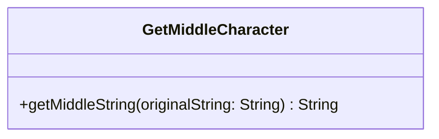

# UML Diagrams

## Pattern: Idiomatic Kotlin Functional Chain
The implementation uses `drop` to skip the first half and `take` to extract the middle part, avoiding manual index calculations and `IndexOutOfBoundsException` on empty strings.
